<p align="center">
  <picture>
    <source media="(prefers-color-scheme: dark)" srcset="assets/icons/logo.svg">
    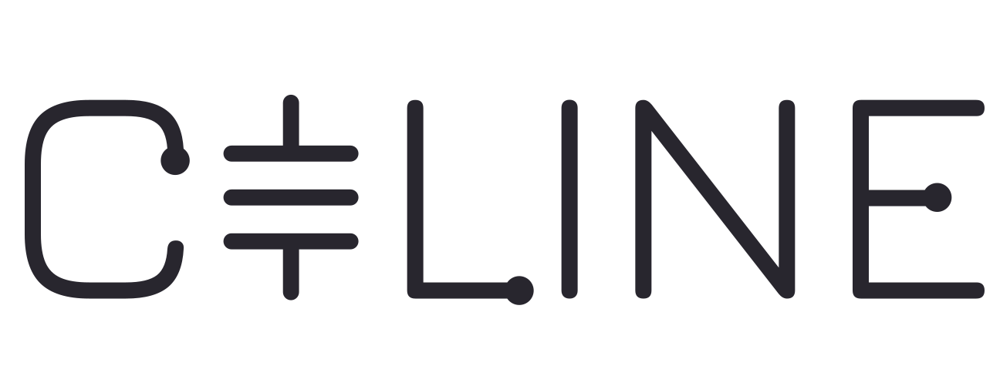
  </picture>
  <br><br>
  <picture>
    <source media="(prefers-color-scheme: dark)" srcset="assets/designer.svg">
    
  </picture>
</p>

<p align="center">
  <b>Realtime SPICE based circuit simulator.</b><br>
  Your schematic, solved every sample, live.
</p>

<p align="center">
  <a href="https://github.com/Celine-audio/Celine/releases/latest"></a>
  
  
  <a href="COPYING"></a>
</p>

<p align="center">
  <a href="https://github.com/Celine-audio/Celine/releases/latest"><b>Download</b></a> ·
  <a href="https://celine-audio.github.io/CelineWebsite/">Website</a> ·
  <a href="https://github.com/Celine-audio/CelineEngine/blob/main/LIMITATIONS.md">Known limitations</a>
</p>

<p align="center">
  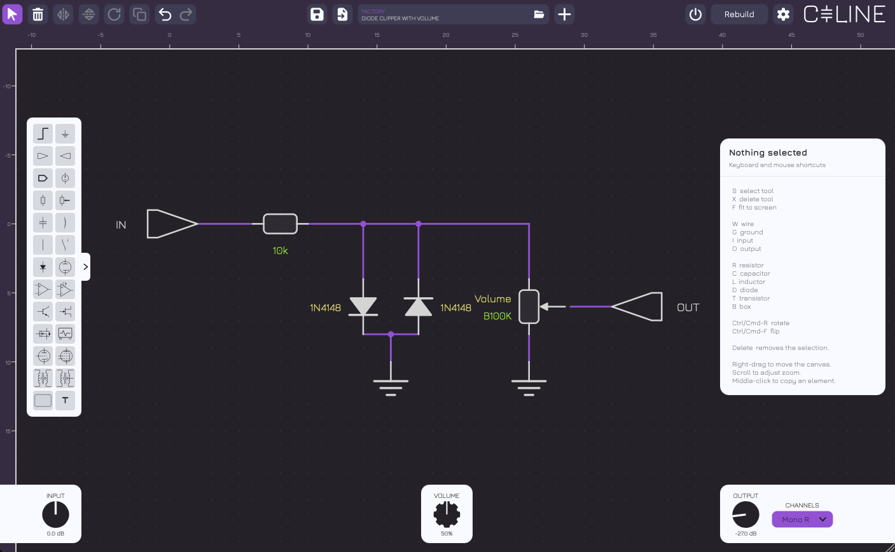
</p>

> [!WARNING]
> **Turn your monitors down first.** A wrong value can cause very loud audio levels.

## How it works

<table>
  <tr>
    <td align="center" width="33%">
      <br>
      <b>1 · Draw</b><br>
      <sub>Place parts and wire them on the sheet.</sub>
    </td>
    <td align="center" width="33%">
      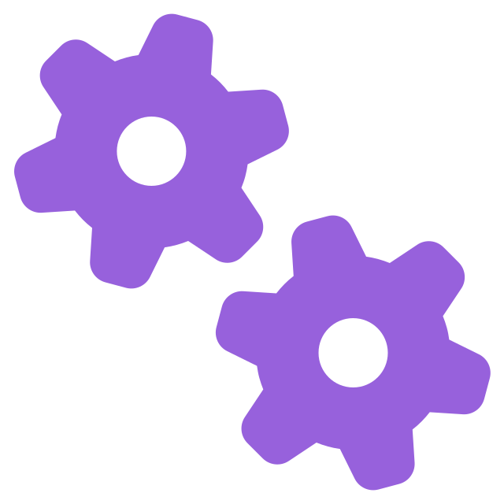<br>
      <b>2 · Rebuild</b><br>
      <sub>The engine computes the circuit's equations and solves them every sample.</sub>
    </td>
    <td align="center" width="33%">
      <br>
      <b>3 · Play</b><br>
      <sub>Every potentiometer and switch becomes controllable along the bottom, seamlessly.</sub>
    </td>
  </tr>
</table>

## Parts

<table>
  <tr>
    <td align="center"><br><sub>Resistor</sub></td>
    <td align="center">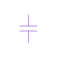<br><sub>Capacitor</sub></td>
    <td align="center">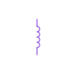<br><sub>Inductor</sub></td>
    <td align="center">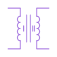<br><sub>Transformer</sub></td>
    <td align="center"><br><sub>Potentiometer</sub></td>
    <td align="center"><br><sub>Diode</sub></td>
  </tr>
  <tr>
    <td align="center">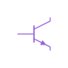<br><sub>BJT</sub></td>
    <td align="center">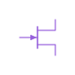<br><sub>JFET</sub></td>
    <td align="center">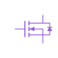<br><sub>MOSFET</sub></td>
    <td align="center">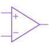<br><sub>Op-amp</sub></td>
    <td align="center"><br><sub>Triode</sub></td>
    <td align="center"><br><sub>Pentode</sub></td>
  </tr>
</table>

Every non-linear part is fitted to its maker's datasheet; valves follow equations described in
[Norman Koren](https://www.normankoren.com/Audio/index.html) and
[Dempwolf & Zölzer](https://dafx.de/paper-archive/2011/Papers/76_e.pdf).

<table>
  <tr><td></td><td><b>Linked controls</b></td><td>Give pots or switches the same name and they share one control.</td></tr>
  <tr><td></td><td><b>File playback</b></td><td>Feed the Input from an audio file to benchmark the sheet without needing live input.</td></tr>
  <tr><td>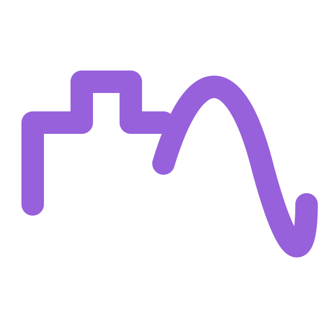</td><td><b>Oversampling</b></td><td>2× to 16×.</td></tr>
  <tr><td></td><td><b>Calibrated levels</b></td><td>INPUT and OUTPUT can read in dBu, to match NAM captures.</td></tr>
  <tr><td></td><td><b>Presets</b></td><td><code>.celsch</code> files hold the drawing and the knob positions, in a searchable library.</td></tr>
</table>

## Shortcuts

| Keys | Does |
|---|---|
| <kbd>S</kbd> <kbd>W</kbd> <kbd>X</kbd> | Select, wire, delete |
| <kbd>R</kbd> <kbd>C</kbd> <kbd>L</kbd> <kbd>T</kbd> <kbd>D</kbd> <kbd>G</kbd> <kbd>I</kbd> <kbd>O</kbd> <kbd>B</kbd> | Resistor, capacitor, inductor, transistor, diode, ground, input, output, box |
| <kbd>F</kbd> | Fit the drawing to the window |
| <kbd>Cmd</kbd>/<kbd>Ctrl</kbd> + <kbd>R</kbd> · <kbd>F</kbd> | Rotate · flip |
| Right-drag · wheel · middle-click | Pan · zoom · clone |

## Install

| | Formats |
|---|---|
| **macOS** 11+ | VST3 · AU · CLAP · LV2 · Standalone |
| **Windows** | VST3 · CLAP · LV2 · Standalone (ASIO, WASAPI, DirectSound) |
| **Linux** | VST3 · CLAP · LV2 · Standalone |

> [!NOTE]
> The builds are not code-signed, so Gatekeeper and SmartScreen will warn on first run.
> On macOS, clear each file you install with:
> ```bash
> xattr -d com.apple.quarantine <file_path>
> ```

<p>
  
  &nbsp;&nbsp;&nbsp;&nbsp;&nbsp;&nbsp;&nbsp;&nbsp;
  <picture>
    <source media="(prefers-color-scheme: dark)" srcset="docs/logos/VST.png">
    
  </picture>
  &nbsp;&nbsp;&nbsp;&nbsp;&nbsp;&nbsp;&nbsp;&nbsp;
  <picture>
    <source media="(prefers-color-scheme: dark)" srcset="docs/logos/AU-onwhite.svg">
    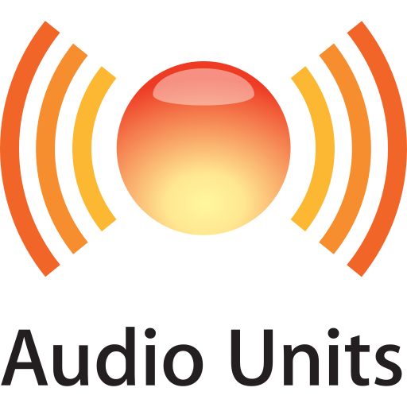
  </picture>
  &nbsp;&nbsp;&nbsp;&nbsp;&nbsp;&nbsp;&nbsp;&nbsp;
  <picture>
    <source media="(prefers-color-scheme: dark)" srcset="docs/logos/CLAP-white.png">
    
  </picture>
  &nbsp;&nbsp;&nbsp;&nbsp;&nbsp;&nbsp;&nbsp;&nbsp;
  <picture>
    <source media="(prefers-color-scheme: dark)" srcset="docs/logos/lv2_white.svg">
    
  </picture>
</p>

## Build

Needs **CMake 3.25+** and a **C++23** compiler. The submodules are required (JUCE, the
engine, the shared CMake modules and the CLAP wrapper):

```bash
git clone --recursive https://github.com/Celine-audio/Celine.git
cmake -B Builds -DCMAKE_BUILD_TYPE=Release
cmake --build Builds
ctest --test-dir Builds --output-on-failure
```

If you cloned without `--recursive`, run `git submodule update --init --recursive`.
Add `-G Ninja` if available. On macOS, `-DCMAKE_OSX_ARCHITECTURES="arm64;x86_64"` builds a
universal binary.

Built on [JUCE](https://juce.com) 9, with the build system derived from
[Pamplejuce](https://github.com/sudara/pamplejuce) and CLAP from
[clap-juce-extensions](https://github.com/free-audio/clap-juce-extensions).

## Licence


Céline is free software under the [GNU AGPL v3](COPYING), inherited from JUCE's free licence.
The full notices are in [`LICENSE`](LICENSE) and [`THIRD-PARTY-NOTICES`](THIRD-PARTY-NOTICES),
and in the plugin under **Settings → About**.

Using it costs nothing and obliges nothing: the audio you record and the circuits you draw
are yours. You may fork and modify it, provided you do so under the AGPLv3.

Provided as-is, without warranty of any kind. Céline aims to emulate analogue circuits
faithfully but makes no guarantee about the accuracy of its simulations.

**AI disclosure.** Céline contains no AI. AI assistants were used alongside the authors
during development; Céline remains the authors' work.

<details>
<summary><b>Credits</b></summary>

- Icons from [Font Awesome Free](https://fontawesome.com), under [CC BY 4.0](https://creativecommons.org/licenses/by/4.0/)
- Typeface [Jura](https://github.com/ossobuffo/jura), by Daniel Johnson with Alexei Vanyashin and Mirko Velimirovic
- Typeface [JetBrains Mono](https://github.com/JetBrains/JetBrainsMono), © 2020 The JetBrains Mono Project Authors, under the SIL OFL 1.1
- VST® and ASIO® are registered trademarks of Steinberg Media Technologies GmbH
- ASIO Interface Technology by Steinberg Media Technologies GmbH. The
  [ASIO SDK](https://www.steinberg.net/developers/asiosdk-open/) is dual-licensed under
  Steinberg's own licence or the GPLv3; Céline takes the GPL option, which is what lets an
  ASIO-enabled build stay AGPLv3
- Valve models after [Norman Koren](https://www.normankoren.com/Audio/index.html) and after
  Dempwolf & Zölzer, "[A physically-motivated triode model for circuit simulations](https://dafx.de/paper-archive/2011/Papers/76_e.pdf)" (DAFx-11)

</details>
